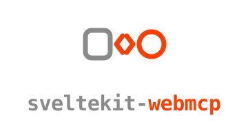

<p align="center"></p>

# sveltekit-webmcp

WebMCP for SvelteKit. Let AI agents use your app through tools you define, written the Svelte way:
runes, `{@attach}` attachments, `createContext`, `createSubscriber`, and SvelteKit remote functions.

[WebMCP](https://webmachinelearning.github.io/webmcp/) is a W3C Community Group draft. A page
registers tools on `document.modelContext`, and a browser agent can discover and call them. It runs
in a Chrome and Edge origin trial today; elsewhere you can use the
[official polyfill](https://www.npmjs.com/package/@w3c/webmcp-polyfill).

## Install

```sh
pnpm add sveltekit-webmcp
# optional, for browsers without the native API
pnpm add @w3c/webmcp-polyfill
```

Peers: `svelte` 5.57+, `@sveltejs/kit` 3. The only runtime dependency is the Standard Schema types.

## Quick start

```svelte
<script lang="ts">
	import { tool } from 'sveltekit-webmcp';
	import * as z from 'zod';

	let todos = $state<string[]>([]);

	const addTodo = tool({
		name: 'add_todo',
		description: 'Add an item to the todo list',
		input: z.object({ text: z.string().min(1) }),
		execute: ({ text }) => {
			todos.push(text);
			return `Added "${text}"`;
		}
	});
</script>

{#if addTodo.registered}<p>Agent ready</p>{/if}
```

The tool registers when the component mounts and unregisters when it is destroyed. Input is
validated before `execute` runs; invalid input comes back to the agent as an `isError` result that
lists the issues, so it can retry.

## Entry points

| Import                                | Contents                                                                                                |
| ------------------------------------- | ------------------------------------------------------------------------------------------------------- |
| `sveltekit-webmcp`                    | `tool`, `attachTool`, `setWebMCP`, `getWebMCP`, `registeredTools`, `isSupported`, `toolActivity`, types |
| `sveltekit-webmcp/kit`                | `commandTool`, `queryTool`, `formTool`, `navigateTool`, `pageContextTool`, `searchTool`                 |
| `sveltekit-webmcp/server`             | `webmcpHandle`, `mcpHandle`, `serverTool`                                                               |
| `sveltekit-webmcp/devtools`           | `WebMCPDevtools`                                                                                        |
| `sveltekit-webmcp/testing`            | `mockModelContext`, `callTool`, `waitForTool`                                                           |
| `sveltekit-webmcp/testing/playwright` | `test` and `expect` with a `webmcp` fixture                                                             |

The Playwright fixture has its own entry so browser unit tests never pull in `@playwright/test`.

## Guide

### Reactive options and `enabled`

Pass a getter instead of an object. It is tracked; the tool re-registers only when its
agent-visible shape (name, title, description, schemas, annotations) changes. `execute` is always
read fresh, so closures over `$state` never go stale.

```ts
const flyTo = tool(() => ({
	name: 'fly_to',
	description: t('tools.flyTo'), // locale change -> re-register
	enabled: map.loaded, // false unregisters
	input: flySchema,
	execute: ({ lng, lat }) => map.flyTo({ center: [lng, lat] })
}));
```

### Run state

Every tool exposes `registered`, `running`, `error` and `callCount` (`$state`) plus `lastResult` and
`lastInput` (`$state.raw`). `tool.call(input)` runs it locally through the same validation path,
handy for buttons and tests.

### Results

Return a string for text, an object for JSON text, or nothing for `"ok"`. A throw becomes an
`isError` result, never an unhandled rejection. With an `output` schema the raw object is returned
as structured content and checked in development. `execute(input, { signal, element })` gets a
signal that aborts when the agent cancels or the tool unmounts.

### Annotations, confirmation, limits

```ts
tool({
	name: 'transfer',
	description: 'Move money between accounts',
	consequential: true, // asks the user first; declined -> "User declined"
	untrusted: false, // true for user-written output; dev warning on invisible Unicode
	limit: { calls: 5, per: '1m' }, // client-side; over the limit -> "Rate limited"
	input: transferSchema,
	execute: (input) => bank.transfer(input)
});
```

Short names map to the draft's `readOnlyHint`, `consequentialHint`, `untrustedContentHint` and
`debugging`. Server-side limits stay your app's job.

### Element tools with `attachTool()`

```svelte
{#each markers as marker (marker.id)}
	<button
		{@attach attachTool(() => ({
			name: `open_marker_${marker.id}`,
			description: `Open popup for ${marker.label}`,
			execute: (_input, { element }) => marker.open(element)
		}))}>{marker.label}</button
	>
{/each}
```

Rendered means registered; removed by `{#if}` or `{#each}` means unregistered.

### App config with `setWebMCP()`

```svelte
<!-- +layout.svelte -->
<script lang="ts">
	import { setWebMCP } from 'sveltekit-webmcp';

	setWebMCP({
		polyfill: () => import('@w3c/webmcp-polyfill'), // or `true` once the package is installed
		prefix: 'shop_',
		confirm: (request) => confirmDialog.ask(request),
		onError: (error, toolName) => console.error(toolName, error),
		exposedTo: []
	});
</script>
```

Optional. Without it: no polyfill, `window.confirm` for confirmation, no prefix. Without a polyfill
the package checks for a late-injected model context (browser extensions) every 500 ms for 10 s.
`registeredTools.current` lists the tools on the page and `isSupported.current` says whether a
model context exists; both are reactive.

### Remote functions

Keep schemas in a shared module (Kit does not allow exporting them from a `.remote.ts` file).

```ts
// todos.schema.ts
export const addTodoSchema = z.object({ text: z.string().min(1) });

// todos.remote.ts
export const addTodo = command(addTodoSchema, async ({ text }) => db.add(text));
export const getTodos = query(async () => db.list());
```

```svelte
<script lang="ts">
	import { commandTool, formTool, queryTool } from 'sveltekit-webmcp/kit';

	commandTool(addTodo, { name: 'add_todo', description: 'Add a todo', input: addTodoSchema });
	queryTool(getTodos, { name: 'list_todos', description: 'List todos' }); // read-only
</script>

<form
	{...createPost}
	{@attach formTool(createPost, {
		name: 'create_post',
		description: 'Write and publish a blog post',
		input: postSchema
	})}
>
	<input {...createPost.fields.title.as('text')} />
	<textarea {...createPost.fields.content.as('text')}></textarea>
	<button>Publish</button>
</form>
```

The real remote function runs, so server validation and single-flight refreshes keep working.
`formTool` fills the fields (the user sees it), submits through the form element and returns
`result`, or the field issues as an `isError` result. It is consequential by default. Use `toArg`
when a remote function takes a plain value: `toArg: ({ slug }) => slug`.

### Navigation, page context, search

```ts
navigateTool({
	routes: { '/': { description: 'Home' }, '/blog/[slug]': { description: 'A post' } }
});
pageContextTool({ fields: { routeId: true, params: true, title: true, data: ['product'] } });
searchTool({
	description: 'Search posts',
	search: ({ query, limit }) => searchPosts({ query, limit })
});
```

`navigateTool` only opens listed routes, built with `resolve()`. `pageContextTool` never shares a
`page.data` key you did not name.

### Server

```ts
// hooks.server.ts
import { sequence } from '@sveltejs/kit/hooks';
import { WEBMCP_OT } from '$app/env/private';
import { mcpHandle, serverTool, webmcpHandle } from 'sveltekit-webmcp/server';

export const handle = sequence(
	webmcpHandle({ originTrialToken: WEBMCP_OT, allow: ['self'] }),
	mcpHandle({
		tools: [
			serverTool({
				name: 'list_todos',
				description: 'List todos',
				readOnly: true,
				server: true,
				execute: (_input, event) => db.todos(event.locals.user)
			}),
			serverTool({
				name: 'search_todos',
				description: 'Search todos',
				input: searchTodosSchema,
				readOnly: true,
				server: true,
				execute: (input) => searchTodos(input) // remote functions work here too
			})
		],
		authorize: ({ locals }) => !!locals.user
	})
);
```

`webmcpHandle` adds `Origin-Trial` and `Permissions-Policy: tools=(self)` to HTML responses.
`mcpHandle` serves `/mcp` (MCP Streamable HTTP, JSON responses) for non-browser agents; only tools
marked `server: true` are listed, and each one receives the request event. Remote functions
can be called from `execute`, so the same query or command serves both kinds of agent.

### Devtools

```svelte
<script lang="ts">
	import { WebMCPDevtools } from 'sveltekit-webmcp/devtools';
</script>

<WebMCPDevtools />
```

Renders only in dev (or with `force`). Lists live tools, shows recent calls, and fires tools by
hand. Theme it with `--webmcp-bg`, `--webmcp-fg`, `--webmcp-accent` and friends.

### Testing

```ts
import { render } from 'vitest-browser-svelte';
import { callTool, mockModelContext, waitForTool } from 'sveltekit-webmcp/testing';

test('add_todo adds an item', async () => {
	const ctx = mockModelContext();
	render(TodoPage);
	await waitForTool('add_todo');
	const res = await callTool('add_todo', { text: 'milk' });
	expect(res.isError).toBe(false);
	ctx.restore();
});
```

```ts
import { expect, test } from 'sveltekit-webmcp/testing/playwright';

test('agent can add a todo', async ({ page, webmcp }) => {
	await page.goto('/todos');
	await webmcp.waitForTool('add_todo');
	expect((await webmcp.callTool('add_todo', { text: 'milk' })).isError).toBe(false);
});
```

## Schemas

Any [Standard Schema](https://standardschema.dev) works for validation. Agents get JSON Schema
from libraries that implement Standard JSON Schema (Zod 4, ArkType 2, Valibot through
`@valibot/to-json-schema`). A raw JSON Schema object works too.

## Developing

```sh
pnpm install
pnpm dev          # docs site with live demos
pnpm check
pnpm lint
pnpm test:unit    # unit + browser component tests
pnpm test:e2e     # builds, then runs Playwright against the docs site with the polyfill
pnpm build        # docs site + package + publint
```

`WEBMCP_NATIVE=1 pnpm test:e2e` adds a run in installed Chrome with the native API
turned on (`--enable-features=WebMCP`). If your stable Chrome does not ship it yet,
point the run at another channel, for example `WEBMCP_CHANNEL=chrome-dev`.

The docs site is markdown: one page per area in `src/content/docs`, rendered by mdsvex
at `/docs/[...slug]`, with the live demos in `src/docs/demos`. It deploys to Vercel;
`WEBMCP_OT` (optional) sets the origin trial token.

## License

MIT
